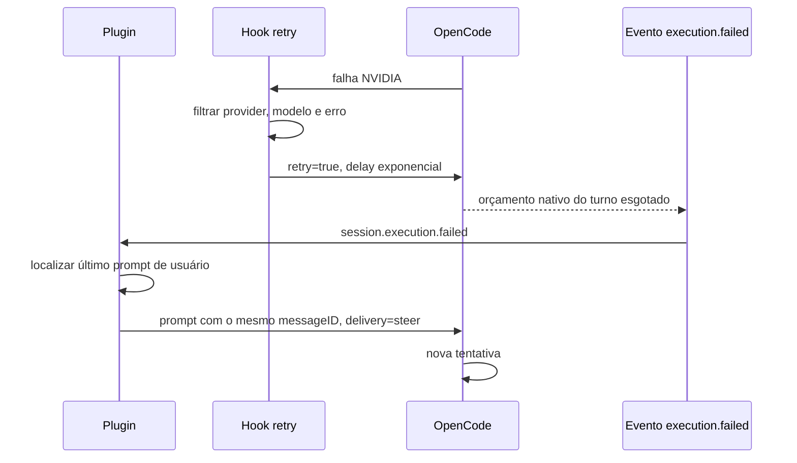

# OpenCode NVIDIA Retry

[](https://github.com/marcelinosandroni/opencode-nvidia-retry/actions/workflows/ci.yml)
[](LICENSE)

Plugin para **OpenCode V2** que continua tentando erros de provider NVIDIA, inclusive depois que o orçamento de retries do turno termina. O backoff é exponencial e nunca ultrapassa **60 segundos** entre tentativas.

Por padrão, o plugin age somente quando:

- o provider é `nvidia`;
- o erro é classificado pelo servidor como `provider.rate-limit` ou `provider.internal`;
- a sessão não foi excluída pelas opções de escopo.

O cliente móvel pode apresentar esse incidente como `the provider had a problem`. No servidor OpenCode, o mesmo erro costuma aparecer como HTTP 429 (`provider.rate-limit`) ou uma falha interna do endpoint (`provider.internal`). O padrão cobre as duas classificações, sem depender do texto exibido pelo cliente.

Ele não modifica o core do OpenCode e usa apenas APIs públicas de plugin.

## Compatibilidade

- **OpenCode:** V2, a partir da versão `2.4.1`, testada neste repositório.
- **Runtime:** Node.js 20+ ou Bun.
- **APIs usadas:** `ctx.session.hook("retry")`, eventos públicos de execução e `ctx.session.prompt`.

## Instalação

Adicione o pacote GitHub à lista `plugins` da configuração global:

```json
{
  "$schema": "https://opencode.ai/config.json",
  "plugins": [
    "github:marcelinosandroni/opencode-nvidia-retry"
  ]
}
```

O OpenCode recarrega plugins automaticamente após a alteração da configuração. Não é necessário reiniciar o servidor.

Para instalar pelo CLI:

```bash
opencode plugin add github:marcelinosandroni/opencode-nvidia-retry
```

Confirme o carregamento com:

```bash
opencode plugin list
```

A saída deve conter:

```text
opencode.nvidia-retry
```

## Configuração

A configuração é opcional. Para passar opções, use a forma de objeto:

```json
{
  "$schema": "https://opencode.ai/config.json",
  "plugins": [
    {
      "package": "github:marcelinosandroni/opencode-nvidia-retry",
      "options": {
        "enabled": true,
        "providerIDs": ["nvidia"],
        "modelIDs": [],
        "errorTypes": ["provider.rate-limit", "provider.internal"],
        "errorMessages": [],
        "sessions": [],
        "excludeSessions": [],
        "initialDelay": 1000,
        "maxDelay": 60000
      }
    }
  ]
}
```

| Opção | Tipo | Padrão | Descrição |
| --- | --- | --- | --- |
| `enabled` | `boolean` | `true` | Desative com `false` para não registrar nenhum comportamento de retry. |
| `providerIDs` | `string[]` | `["nvidia"]` | Providers elegíveis. A lista é comparada sem diferenciar maiúsculas de minúsculas. |
| `modelIDs` | `string[]` | `[]` | Modelos elegíveis. Lista vazia permite todos os modelos dos providers selecionados. |
| `errorTypes` | `string[]` | `["provider.rate-limit", "provider.internal"]` | Tipos de erro elegíveis. Lista vazia permite todos os tipos. |
| `errorMessages` | `string[]` | `[]` | Fragmentos que devem aparecer na mensagem ou no corpo da resposta. Lista vazia não aplica filtro de texto; use `"*"` para permitir qualquer texto. |
| `sessions` | `string[]` | `[]` | Quando não está vazio, somente estes IDs de sessão são afetados. |
| `excludeSessions` | `string[]` | `[]` | IDs de sessão que nunca serão afetados. |
| `initialDelay` | `number` | `1000` | Primeiro atraso em milissegundos. |
| `maxDelay` | `number` | `60000` | Teto do atraso em milissegundos. Valores maiores são limitados a `60000`. |

O backoff padrão é `1s, 2s, 4s, 8s, ...`, limitado a `60s`. Não há contagem máxima de tentativas: enquanto o erro continuar correspondendo aos filtros, o plugin tenta novamente.

Consulte [docs/configuration.md](docs/configuration.md) para precedência, exemplos e regras de validação.

## Como funciona

O retry nativo do OpenCode V2 tem uma contagem máxima por turno. Por isso, o plugin usa duas etapas públicas:

1. Durante o turno atual, o hook `retry` torna a falha correspondente elegível para retry e substitui o atraso pelo backoff exponencial do plugin.
2. Se o turno chegar a uma falha terminal, o evento `session.execution.failed` agenda uma nova tentativa. O plugin retoma o último prompt durável de usuário com o mesmo ID de mensagem e `delivery: "steer"`.

Reusing the message ID reconciles the existing message instead of duplicating it. A successful execution clears the retry state; user interruption and session deletion also cancel a pending retry.



Detalhes em [docs/architecture.md](docs/architecture.md).

## Operação e segurança

- O plugin não altera prompts, modelos ou credenciais.
- Ele não faz requisições de rede.
- Em uma falha terminal, consulta o contexto da sessão e reutiliza o texto apenas na chamada pública que retoma o mesmo ID; nada é persistido pelo plugin.
- O estado de retry fica somente em memória e é descartado no hot reload.
- Uma nova execução ou uma troca explícita de modelo durante o backoff cancela a retomada automática.
- Use `enabled: false` para desativar o plugin sem removê-lo da configuração.

Leia [SECURITY.md](SECURITY.md) para detalhes.

## Limitações

- O erro deve continuar correspondente aos filtros; se a classificação mudar para outro tipo, o ciclo termina.
- O plugin retoma o último prompt de usuário da sessão. Se ele não existir, não há como reconstruir a requisição.
- Retry infinito pode consumir quota e gerar custo enquanto o provider estiver indisponível.
- O teto de um minuto é rígido por requisito de segurança operacional; configure um valor menor se necessário.

## Desenvolvimento

```bash
npm install
npm run check
```

- `npm run typecheck`: valida os tipos com TypeScript estrito.
- `npm test`: executa os testes unitários.
- `npm run check`: executa typecheck e testes.

Veja [docs/development.md](docs/development.md) para o fluxo completo.

## Documentação

- [Arquitetura](docs/architecture.md)
- [Configuração](docs/configuration.md)
- [Compatibilidade](docs/compatibility.md)
- [Desenvolvimento](docs/development.md)

## Problemas e contribuições

Abra uma issue em [Issues](https://github.com/marcelinosandroni/opencode-nvidia-retry/issues). Contribuições são bem-vindas; leia [CONTRIBUTING.md](CONTRIBUTING.md).

## Licença

[MIT](LICENSE) © 2026 Marcelino Sandroni.
